<!--
     ══════════════════════════════════════════════════════════════════════════
     HARMIT KALAL (@Harmitx7) // ARCHITECTURAL DEVELOPER PORTFOLIO
     Rendered as a stack of animated SVG cards by scripts/render_cards.py.
     Refreshed automatically via scheduled GitHub Action (.github/workflows/update-profile.yml).
     Embedded typography (Geist Mono, Geist) & hardware-accelerated CSS keyframes.
     ══════════════════════════════════════════════════════════════════════════
-->

<!-- 01 // SIGNATURE HERO -->
 

<!-- 02 // 53-WEEK CONTRIBUTION GRAPH (BRAND CYAN/MINT PALETTE) -->
 

<!-- 03 // MONTHLY ACTIVITY SPECTRUM (STREAK, ACTIVE DAYS & BUSIEST DAY) -->
 

<!-- 04 // THREE LINKED TILES IN A ROW (EACH AT WIDTH 32.5%) -->
   

<!-- 05 // ONE CARD PER FEATURED REPO (EACH AT WIDTH 32.5%) -->
   

<!-- 06 // CLOSING SIGNATURE HUD -->

  <a href="https://harmit.vercel.app">harmit.vercel.app</a> &nbsp;/&nbsp;
  <a href="https://github.com/Harmitx7">github</a> &nbsp;/&nbsp;
  <a href="https://linkedin.com/in/harmitkalal">linkedin</a> &nbsp;/&nbsp;
  <a href="https://www.npmjs.com/package/tribunal-kit">npm</a> &nbsp;/&nbsp;
  <a href="mailto:harmitkalal7@gmail.com">email</a>

