<!--
     ══════════════════════════════════════════════════════════════════════════
     HARMIT KALAL (@Harmitx7) — EDITORIAL DEVELOPER PORTFOLIO
     Rendered as a suite of animated SVG cards by scripts/render_cards.py.
     Refreshed automatically via scheduled GitHub Action (.github/workflows/update-profile.yml).
     Embedded typography (Instrument Serif, Geist, Geist Mono) & hardware-accelerated CSS keyframes.
     ══════════════════════════════════════════════════════════════════════════
-->

<!-- SECTION A: EDITORIAL HERO -->
 

<!-- SECTION B: ANNUAL CONTRIBUTION GRAPH (COBALT EDITORIAL PALETTE) -->
 

<!-- SECTION C: MONTHLY GITHUB ACTIVITY (EDITORIAL DATA VISUALIZATION) -->
 

<!-- SECTION D: FEATURED EDITORIAL REPOSITORIES -->
   

<!-- SECTION E: EDITORIAL COLOPHON & FOOTER -->

  <a href="https://harmit.vercel.app">harmit.vercel.app</a> &nbsp;·&nbsp;
  <a href="https://github.com/Harmitx7">github</a> &nbsp;·&nbsp;
  <a href="https://linkedin.com/in/harmitkalal">linkedin</a> &nbsp;·&nbsp;
  <a href="mailto:harmitkalal7@gmail.com">email</a>

