# Component Architecture & Visual Specifications: Editorial OS

**Document**: `design/components.md`  
**Target Repository**: `Harmitx7/Harmitx7`  
**Specification Level**: Handcrafted SVG Geometries & Markdown Composition Standards

---

## 1. Component Suite Overview

The GitHub profile experience is structured into seven modular, decoupled visual components:

```
┌─────────────────────────────────────────────────────────────┐
│ 1. HERO CYBER-HUD BANNER (hero.svg)                         │
├─────────────────────────────────────────────────────────────┤
│ 2. SOCIAL NAVIGATION DOCK (Editorial Badges)                │
├─────────────────────────────────────────────────────────────┤
│ 3. ACTIVE TELEMETRY TICKER (status-bar.svg)                 │
├─────────────────────────────────────────────────────────────┤
│ 4. DEVELOPER CONSOLE MANIFEST (terminal-boot.svg)           │
├─────────────────────────────────────────────────────────────┤
│ 5. FEATURED PROJECT DOSSIERS (Markdown Grid Table)          │
├─────────────────────────────────────────────────────────────┤
│ 6. DYNAMIC DATA VISUALIZATION ENGINE (assets/generated/)     │
│    ├── languages.svg (Language Spectrum Matrix)             │
│    └── metrics-hud.svg (Real GitHub Telemetry HUD)          │
├─────────────────────────────────────────────────────────────┤
│ 7. 4-TIER SKILL ARCHITECTURE MATRIX (skill-tree.svg)        │
├─────────────────────────────────────────────────────────────┤
│ 8. ARCHITECTURAL PRINCIPLES & DESIGN SYSTEM TABLE           │
├─────────────────────────────────────────────────────────────┤
│ 9. CONTRIBUTION SNAKE TELEMETRY (<picture> Dark/Light)      │
├─────────────────────────────────────────────────────────────┤
│ 10. CYBER TELEMETRY FOOTER (footer.svg)                     │
└─────────────────────────────────────────────────────────────┘
```

---

## 2. Component 1: Hero Cyber-HUD Banner (`assets/hero.svg`)

- **ViewBox**: `0 0 1000 400`
- **Aspect Ratio**: 2.5 : 1 (Ultra-wide cinematic aspect ratio)
- **Container Geometry**: Deep cosmic void (`#020205` to `#0A0E1A`), rounded corners `rx="14"`, hairline border gradient `url(#hullRim)` (`#00F0FF` -> `#0F172A` -> `#FF5722`, `stroke-width="1.2"`).
- **Left Zone (Identity & Manifest)**:
  - Coordinate Tag (`y=56`): `23.02°N, 72.57°E // AHMEDABAD, IN` in uppercase monospace `10px`, `#64748B`, `letter-spacing: 2px`.
  - Primary Identity (`y=125`): `Harmit Kalal` in bold display sans `44px`, gradient fill `#FFFFFF` -> `#64748B`.
  - Engineering Mandate (`y=168`): `AI SYSTEMS ARCHITECT // DISTRIBUTED AGENTIC INFRASTRUCTURE` in monospace `13px`, `#00F0FF`, `letter-spacing: 1.5px`.
  - Architecture Pillars (`y=215`–`275`):
    - Pillar 1: `AGENTIC GOVERNANCE` (`tribunal-kit` / 52 agents / Subagent-Driven Development)
    - Pillar 2: `MALWARE DECEPTION` (`ARGUS-X` / Dynamic trigger-graphs / MITRE ATT&CK)
    - Pillar 3: `TELEMETRY SIMULATION` (`F1 Telemetry` / Sub-millisecond physics sim)
- **Right Zone (Orbital Physics Celestial Engine)**:
  - Center: `(cx=770, cy=195)`
  - Orbit Ring A: `rx="135", ry="55", rotate("-28")`, period `22s linear`, cyan electron.
  - Orbit Ring B: `rx="105", ry="42", rotate("38")`, period `15s linear`, tangerine electron.
  - Orbit Ring C: `rx="160", ry="68", rotate("-72")`, period `32s linear`, mint electron.
  - Core Node: `r="8"`, multi-stop radial glow (`#00F0FF`, `#FF5722`).
- **Responsive & Reduced-Motion Rules**:
  - `transform-box: view-box; transform-origin: 770px 195px;` guarantees stable orbital rotation.
  - `@media (prefers-reduced-motion: reduce)` sets all animations to `none` with static full opacity.

---

## 3. Component 2: Active Telemetry Ticker (`assets/status-bar.svg`)

- **ViewBox**: `0 0 960 72`
- **Aspect Ratio**: 13.33 : 1 (Slim horizontal capsule)
- **Container Geometry**: Matte capsule (`rx="12"`, fill `url(#stBarVoid)`, stroke `url(#stBarRim)`, `stroke-width="1"`).
- **Content Layout**:
  - Pod 1 (`x=28`): Live Sonar Beacon (`cx=38, cy=36`) with expanding concentric ripple ring, accompanied by `SYSTEM STATUS: ` in `#475569` and `OPERATIONAL // ALL GATES NOMINAL` in bold `#00E676`.
  - Pod 2 (`x=390`): Focus Ticker: `ACTIVE SPRINT: ` in `#475569` and `tribunal-kit v3.0` in bold `#00F0FF` + ` (Anti-Hallucination SDD)` in `#94A3B8`.
  - Pod 3 (`x=740`): Milestone Callout: `BANK OF INDIA HACKATHON: ` in `#475569` and `WINNER` in bold `#FF9100`.
  - Identity Right Anchor (`x=944`): `@Harmitx7` in monospace `10px`, `#64748B`.

---

## 4. Component 3: Developer Console Manifest (`assets/terminal-boot.svg`)

- **ViewBox**: `0 0 960 520`
- **Aspect Ratio**: 1.84 : 1
- **Container Geometry**: Window frame with macOS-inspired window controls (`cx=30, 48, 66`, fill `#FB7185`, `#FBBF24`, `#34D399` with subtle pulse).
- **Header Bar**:
  - Title: `harmit@system-architect: ~/tribunal-kit/manifest.json` (`font-size: 11.5px`, `#94A3B8`).
  - Right Telemetry: `BUILD: PASS · AGENTS: 52 · REVIEWERS: 21` in tabular numbers.
- **Code Manifest**:
  - 14 numbered code lines (`01` through `14`) in `#334155` font `11px`.
  - Syntax highlighted JSON representing active system parameters:
    - `"engine": "tribunal-kit"`
    - `"architecture": "Subagent-Driven Development (SDD)"`
    - `"agents": 52`
    - `"tribunal_reviewers": 21`
    - `"acf_metrics": { "compression": "27x", "hallucination_rate": "0.00%" }`
  - Bottom Audit Banner (`y=372`): High-contrast capsule with verified seal (`AUDIT PASSED // 0 HALLUCINATIONS DETECTED // ZERO-TRUST CONTRACT ACTIVE`).

---

## 5. Component 4: 4-Tier Skill Architecture Matrix (`assets/skill-tree.svg`)

- **ViewBox**: `0 0 960 500`
- **Aspect Ratio**: 1.92 : 1
- **Container Geometry**: Deep capsule (`rx="14"`, fill `url(#smVoid)`, stroke `url(#smRim)`).
- **Matrix Tiers (26 Audited Modules)**:
  - **Tier 1 — AI & AGENTIC INFRASTRUCTURE** (`y=100`):
    - Color Accent: Electric Cyan (`#00F0FF`)
    - Modules: `LLM Orchestration`, `Subagent-Driven Dev`, `MCP Protocol`, `Semantic Distillation (.acf)`, `Prompt Defense`, `Anti-Hallucination Gates`.
  - **Tier 2 — SYSTEMS & BACKEND ARCHITECTURE** (`y=185`):
    - Color Accent: High-Torque Tangerine (`#FF9100`)
    - Modules: `Python / FastAPI`, `Rust Core Engines`, `Node.js / TypeScript`, `DuckDB & Analytical SQL`, `PostgreSQL`, `Distributed Micro-Workers`.
  - **Tier 3 — WEB & INTERACTIVE ENGINEERING** (`y=270`):
    - Color Accent: Phosphor Mint (`#00E676`)
    - Modules: `Next.js 15 / React`, `tRPC`, `TailwindCSS`, `SVG Engineering`, `60fps Physics Animation`, `Web Vitals Optimization`.
  - **Tier 4 — CYBERSECURITY & CORE INFRASTRUCTURE** (`y=355`):
    - Color Accent: Signal Coral (`#F43F5E`)
    - Modules: `Mobile Threat Analysis`, `Dynamic Deception Layer`, `Docker Containerization`, `CI/CD Automation`, `OWASP Hardening`, `Linux Kernel Telemetry`.

---

## 6. Component 5: Dynamic Data Visualizers (`assets/generated/`)

### A. Language Spectrum Matrix (`assets/generated/languages.svg`)
- **ViewBox**: `0 0 960 180`
- **Objective**: Replace generic third-party language bars with a bespoke, editorial language spectrum calculated directly from real code bytes.
- **Geometry**:
  - Top: Header bar with `LANGUAGE POLYGLOT SPECTRUM` and `TOTAL AUDITED CODE: 12.05 MB`.
  - Middle: Continuous segmented horizontal bar (`y=60`, height `14px`, `rx="7"`) with exact width percentages:
    - JavaScript (54.98%, `#F7DF1E`)
    - Python (23.17%, `#3572A5`)
    - TypeScript (8.23%, `#3178C6`)
    - Java (5.72%, `#B07219`)
    - Rust (2.67%, `#DEA584`)
    - CSS / HTML / Other (5.23%, `#64748B`)
  - Bottom: High-density legend cards with exact byte counts and percentages in tabular monospace numbers.

### B. System Telemetry HUD (`assets/generated/metrics-hud.svg`)
- **ViewBox**: `0 0 960 170`
- **Objective**: Display real GitHub statistics without fabrication or third-party service latency.
- **Geometry**:
  - 4 Balanced Modular Pods (`width="220"`, `height="100"`, `rx="8"`, fill `#0C1017`, stroke `#1E293B`):
    - Pod 1: `PUBLIC REPOSITORIES` -> Value: `15` (`#F8FAFC`, display 28px).
    - Pod 2: `TOTAL STARS` -> Value: `11` (`#00F0FF`, display 28px).
    - Pod 3: `TOTAL FORKS` -> Value: `1` (`#FF9100`, display 28px).
    - Pod 4: `COMMUNITY FOLLOWERS` -> Value: `7` (`#00E676`, display 28px).
  - Bottom Status Banner: Real timestamp of last synchronization (`LAST SYNCED: YYYY-MM-DD HH:MM UTC // PIPELINE PASS`).

---

## 7. Component 6: Coordinate & Verification Footer (`assets/footer.svg`)

- **ViewBox**: `0 0 1000 140`
- **Aspect Ratio**: 7.14 : 1
- **Content**:
  - Top Luminous Hairline Gradient (`#00F0FF` -> `#FF9100`).
  - Dual Harmonic Waveforms (`d="M 0 42 Q 125 16, 250 42 T 500 42..."` in cyan and tangerine).
  - Center Location Identity (`y=80`): `AHMEDABAD, IN (23.02°N, 72.57°E) · COMPUTER ENGINEERING · INDUS UNIVERSITY` in monospace `10.5px`, `#64748B`, `letter-spacing: 2px`.
  - Bottom Verification Nodes: Quad-color signal dots (`#00F0FF`, `#38BDF8`, `#FF9100`, `#00E676`).

---

## 8. Markdown Integration Standards

In `README.md`, all components are assembled with strict semantic Markdown:
1. Centered layout blocks (`<div align="center">`) with fluid image sizing (`width="100%"` or `width="96%"`).
2. Descriptive, accessible `alt` text on every image tag.
3. Clean table formatting for project showcases (`<td width="50%" valign="top">`) with syntax-highlighted quick starts.
4. Native `<picture>` tag for the contribution snake to handle dark/light mode seamlessly:
   ```html
   <picture>
     <source media="(prefers-color-scheme: dark)" srcset="https://raw.githubusercontent.com/Harmitx7/Harmitx7/output/github-contribution-grid-snake-dark.svg"/>
     <source media="(prefers-color-scheme: light)" srcset="https://raw.githubusercontent.com/Harmitx7/Harmitx7/output/github-contribution-grid-snake.svg"/>
     
   </picture>
   ```
5. Zero broken external badges or unverified stats widgets.
